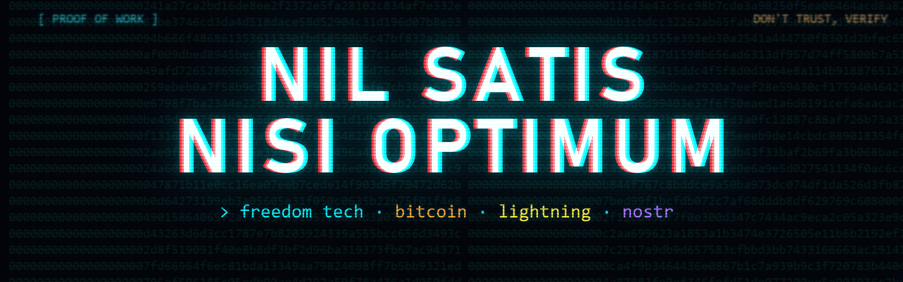
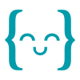

  
About me

   

### Hey, I'm Seydi

**Full Stack JavaScript/TypeScript Engineer & React Native Developer** 
**Programming Instructor & Mentor**

- Web apps with React, Node.js, Vue and Svelte
- Mobile apps with React Native & Expo, published on the App Store and Google Play
- Bitcoin & Nostr developer: Lightning wallets, Nostr protocol, clients and libraries, decentralized identity
- Active open source contributor to JavaScript, TypeScript and Rust projects: AI agents and coding tools, UI tools and education
- Building open-source apps and learning materials for Turkmen speakers
- I just want to be successful enough to help people.

  
Projects

   

**[Shapak-Apps](https://shapak-apps.github.io)** — Open Source Turkmenistan Community · [GitHub](https://github.com/Shapak-Apps)

**[proofstone](https://proofstone.dev)** — Engineering roadmaps you can prove · [GitHub](https://github.com/proofstone)

**[Ykjam Terjime](https://shapak-apps.github.io/ykjam-terjime/)** — Phrasebook & translator · [App Store](https://apps.apple.com/app/ykjam-terjime/id6758071845) · [Google Play](https://play.google.com/store/apps/details?id=com.shapak.translator)

**[Hytaý dili 1](https://github.com/Shapak-Apps/turkmen-chinese)** — Chinese course for Turkmen speakers · [App Store](https://apps.apple.com/app/id6801010061) · [Google Play](https://play.google.com/store/apps/details?id=com.turkmenlearn.chinese)

  
Github Stats

   

  
What I Work With

   

&nbsp;&nbsp;&nbsp;
&nbsp;&nbsp;&nbsp;
&nbsp;&nbsp;&nbsp;
&nbsp;&nbsp;&nbsp;
&nbsp;&nbsp;&nbsp;
&nbsp;&nbsp;&nbsp;
&nbsp;&nbsp;&nbsp;

  
Certificates

   

**Meta** — [Back-End Developer](https://www.coursera.org/account/accomplishments/professional-cert/ZUQQE38VBPVS) · [Full Stack Developer](https://www.coursera.org/account/accomplishments/specialization/QGPE20YYUIYU) · [Front-End Developer](https://www.coursera.org/account/accomplishments/professional-cert/9P5MCCUGRSEB) · [React](https://www.coursera.org/account/accomplishments/specialization/E9H5KJA68HE9)

**IBM** — [Full Stack Software Developer](https://www.coursera.org/account/accomplishments/specialization/GHZRJSZH8PQW) · [Full-Stack JavaScript Developer](https://www.coursera.org/account/accomplishments/specialization/FGG6Q56CBHNM) · [JavaScript Backend Developer](https://www.coursera.org/account/accomplishments/professional-cert/2JD3OW2CZPU1) · [Back-End Development](https://www.coursera.org/account/accomplishments/professional-cert/A6QUCYAFSLYD) · [Front-End Developer](https://www.coursera.org/account/accomplishments/professional-cert/Q7GWJUQ4GCN2)

**Microsoft** — [Full-Stack Developer](https://www.coursera.org/account/accomplishments/specialization/BA53MZBEB26P) · [Back-End Developer](https://www.coursera.org/account/accomplishments/professional-cert/6X8OVTW7WOMP) · [UX Design](https://www.coursera.org/account/accomplishments/professional-cert/WZG0BJ6AZ5IB) · [Front-End Developer](https://www.coursera.org/account/accomplishments/professional-cert/UUFZBRH8QG6Y)

**Codecademy** — [Full-Stack Engineer](https://www.codecademy.com/profiles/SeydiCharyyev/certificates/ffd0f42cce1a44e9a0108b365047a0a6) · [Back-End Engineer](https://www.codecademy.com/profiles/SeydiCharyyev/certificates/810f53d14de24b938cc13c7c2af1e686) · [Front-End Engineer](https://www.codecademy.com/profiles/SeydiCharyyev/certificates/2682884a0719474f96407efe432fdd87)

**HKUST** — [Software Engineering](https://www.coursera.org/account/accomplishments/specialization/HZKJIPNXX4MC)

**Packt** — [MERN Stack Front To Back: Full Stack React, Redux & Node.js](https://www.coursera.org/account/accomplishments/specialization/TR5AG0EHZTUT)

  
Coding Profiles

   

<table width="100%">
  <tr>
    <td width="33%" valign="top" align="center">
      
       
      <strong>LeetCode</strong>
       
      <a href="https://leetcode.com/u/seydi_charyyev/">View profile</a>
       
      
    </td>
    <td width="33%" valign="top" align="center">
      
       
      <strong>Codeforces</strong>
       
      <a href="https://codeforces.com/profile/Seydi">View profile</a>
       
      
    </td>
    <td width="33%" valign="top" align="center">
      
       
      <strong>TopCoder</strong>
       
      Coming soon
       
      
    </td>
  </tr>
  <tr>
    <td width="33%" valign="top" align="center">
      
       
      <strong>CodeChef</strong>
       
      Coming soon
    </td>
    <td width="33%" valign="top" align="center">
      
       
      <strong>HackerRank</strong>
       
      Coming soon
    </td>
    <td width="33%" valign="top" align="center">
      
       
      <strong>HackerEarth</strong>
       
      Coming soon
    </td>
  </tr>
  <tr>
    <td width="33%" valign="top" align="center">
      
       
      <strong>CodeSignal</strong>
       
      Coming soon
    </td>
    <td width="33%" valign="top" align="center">
      
       
      <strong>Codewars</strong>
       
      <a href="https://www.codewars.com/users/Seydi%20Charyyev">View profile</a>
    </td>
    <td width="33%" valign="top" align="center">
      
       
      <strong>CodinGame</strong>
       
      Coming soon
    </td>
  </tr>
  <tr>
    <td width="33%" valign="top" align="center">
      
       
      <strong>Exercism</strong>
       
      Coming soon
    </td>
    <td width="33%" valign="top" align="center">
      
       
      <strong>Kaggle</strong>
       
      Coming soon
    </td>
    <td width="33%" valign="top" align="center">
      
       
      <strong>GeeksforGeeks</strong>
       
      Coming soon
    </td>
  </tr>
</table>

  
Half-Life 3

   
  

